# 1. Install Jenkins on DigitalOcean

## Steps completed

- Created a DigitalOcean server to host Jenkins.
- Set up Docker on the server so Jenkins can run in a container.
- Started Jenkins as a Docker container and exposed its web interface.
- Completed the initial Jenkins setup and prepared it for creating build jobs.

 

# 2. Create a CIPipeline with Jenkinsfile (Freestyle, Pipeline, Multibranch Pipeline)

## Technologies used

- Jenkins
- Docker
- DigitalOcean
- Linux
- Git
- Java
- Maven

 

## Freestyle pipeline

 

### Build Jar File

 

_Successful Maven test and package build._

 

_Jenkins job running the configured build commands._

 

### Build image

_Build-image stage added to the CI flow._

 

_Docker image built successfully._

 

_Created Docker image verified locally._

 

### Push to private Docker repository

_Push-to-repository stage added to the CI flow._

 

_Docker image pushed successfully to the private repository._

 

_Published image available in Docker Hub._

 

### Push to Nexus repository

_Docker image pushed successfully to the Nexus repository._

 

_Published Java Maven image available in Nexus._

 

## Pipeline

The freestyle build steps were replaced with a declarative Jenkins pipeline, which keeps the CI flow defined as code. The pipeline checks out the source code, installs the required tools, and then runs the build app, build image, and deploy stages.

_Jenkins Stage View showing a successful `my-pipeline` run, with all stages completed._

 

## Multibranch pipeline

A multibranch pipeline scans the repository and creates a separate job for each branch that contains a Jenkinsfile. The Jenkinsfile uses `when` conditions on `BRANCH_NAME`, so every branch runs the test stage, while the build and deploy stages run only on `master`.

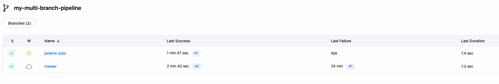
_Branches discovered by `my-multi-branch-pipeline`, with the latest builds of `jenkins-jobs` and `master` successful._

 

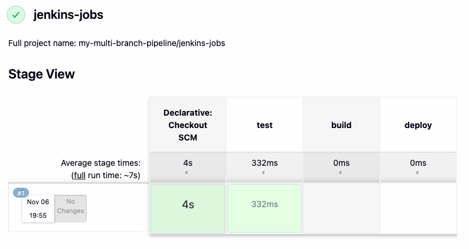
_Build on the `jenkins-jobs` branch, where the build and deploy stages are skipped._

 

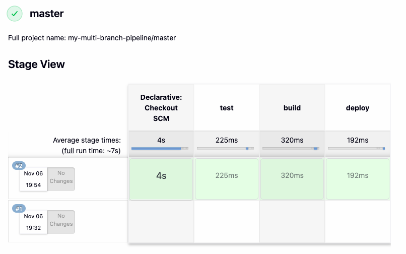
_Build on the `master` branch, where the test, build, and deploy stages all run._

 

# 3. Create a Jenkins Shared Library

Create a Jenkins Shared Library to extract common build logic:

- Create separate Git repository for Jenkins Shared Library project
- Create functions in the JSL to use in the Jenkins pipeline
- Integrate and use the JSL in Jenkins Pipeline (globally and for a specific project in Jenkinsfile)

 

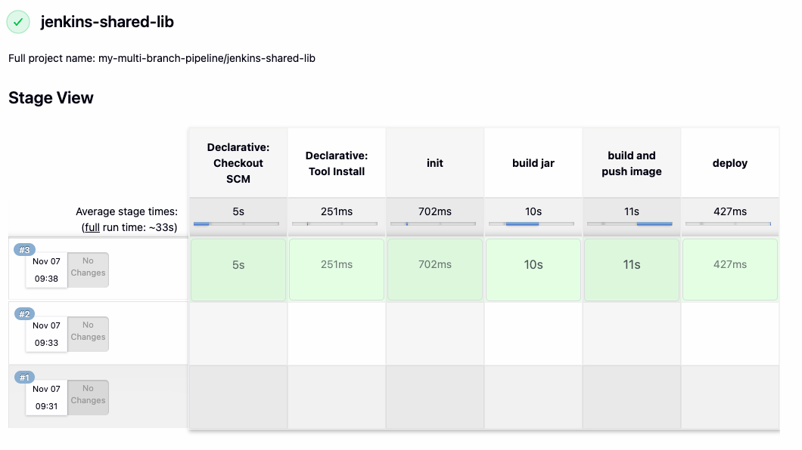
_Stage View of the `jenkins-shared-lib` branch in `my-multi-branch-pipeline`, with build #3 completing all stages._

 

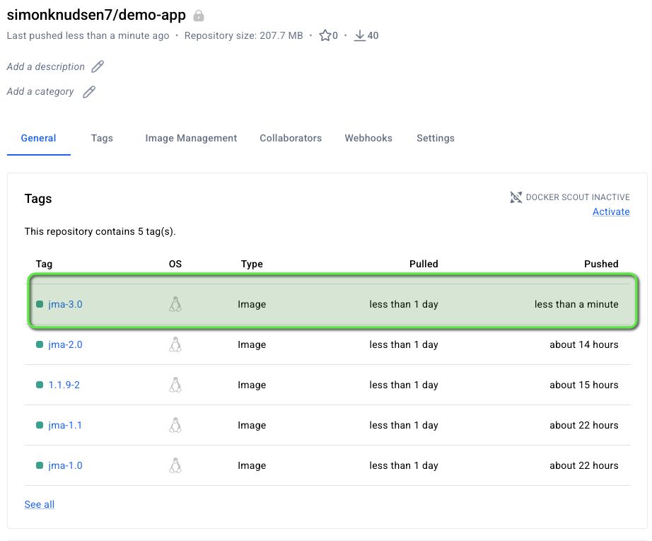
_Image tag `jma-3.0` pushed to the private `simonknudsen7/demo-app` repository on Docker Hub by the pipeline._

 

# 4. Configure Webhook to trigger CI Pipeline automatically on every change

 

- Install the GitHub plugin in Jenkins
- Configure the access token and the connection to Jenkins in the GitHub repository settings
- Configure Jenkins to trigger the CI pipeline whenever a change is pushed to GitHub

 

## Pipeline webhook

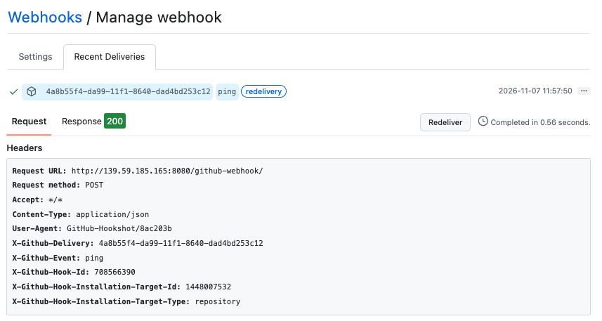
_GitHub webhook delivering a `ping` event to Jenkins at `/github-webhook/`, answered with a `200` response._

 

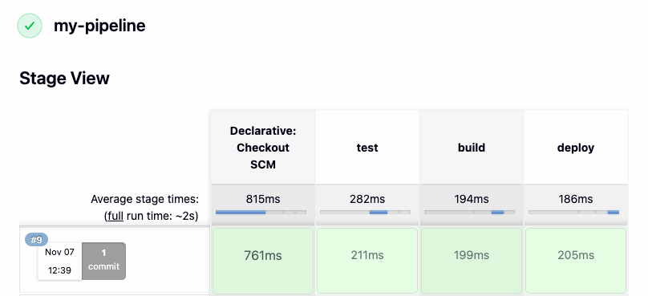
_Build #9 of `my-pipeline`, triggered automatically by a pushed commit, with all stages completed._

 

## Multibranch pipeline webhook

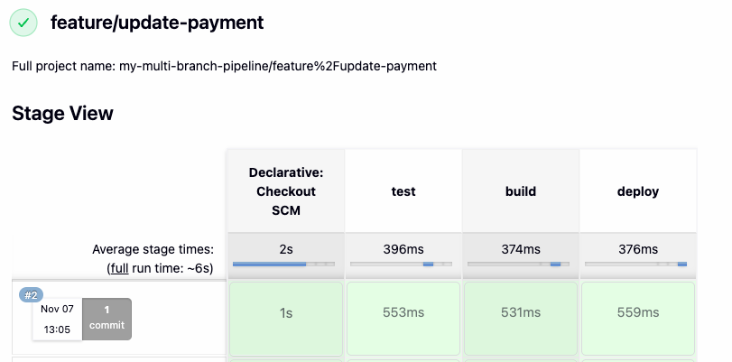
_Build #2 of the `feature/update-payment` branch in `my-multi-branch-pipeline`, triggered automatically by a pushed commit._

 

# 5. Dynamically Increment Application version in Jenkins Pipeline

 

Configure the CI pipeline to increment the application version automatically on every build:

- Configure CI step: Increment patch version
- Configure CI step: Build Java application and clean old artifacts
- Configure CI step: Build Image with dynamic Docker Image Tag
- Configure CI step: Push Image to private Docker Hub repository
- Configure CI step: Commit version update of Jenkins back to Git repository
- Configure Jenkins pipeline to not trigger automatically on CI build commit to avoid commit loop

 

## Pipeline overview

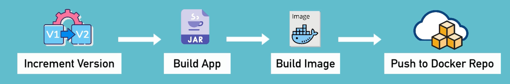
_Flow of the pipeline: increment the version, build the JAR, build the Docker image, and push it to the Docker repository._

 

### Increment the version with Maven

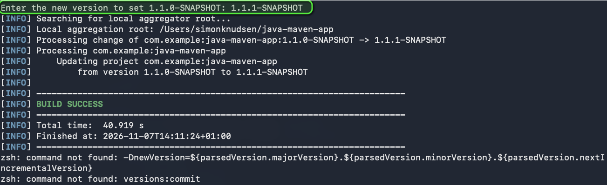
_Running `mvn versions:set` locally to bump the project version from `1.1.0-SNAPSHOT` to `1.1.1-SNAPSHOT`._

 

### Run the pipeline in Jenkins

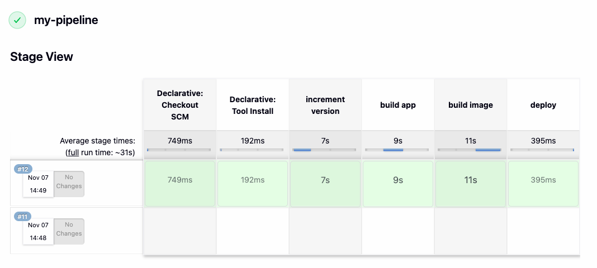
_Build #12 of `my-pipeline`, with the new `increment version` stage completing before the build, image, and deploy stages._

 

### Push the versioned image to Docker Hub

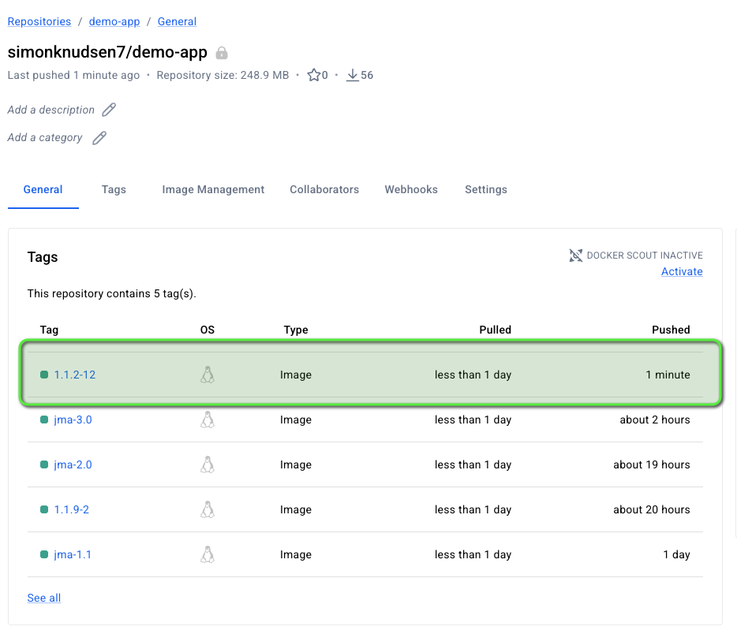
_Image tag `1.1.2-12` in the private `simonknudsen7/demo-app` repository, made from the app version `1.1.2` and Jenkins build number `12`._

 

## Commit version to repo

Every build changes the version in `pom.xml` inside the Jenkins workspace. If that change stays in Jenkins, the next build starts from the old version again and the remote repository never knows about the new one. The last stage of the pipeline commits the updated `pom.xml` and pushes it back to the Git repository, so the version keeps moving forward and developers get it with `git pull`.

 

### Why Jenkins pushes the change back

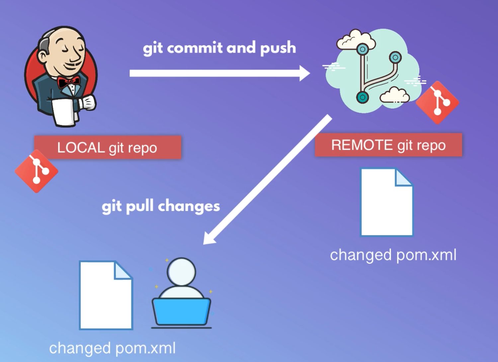
_Jenkins commits and pushes the changed `pom.xml` from its local repository to the remote one, and developers pull the change to stay in sync._

 

### Commit version update stage

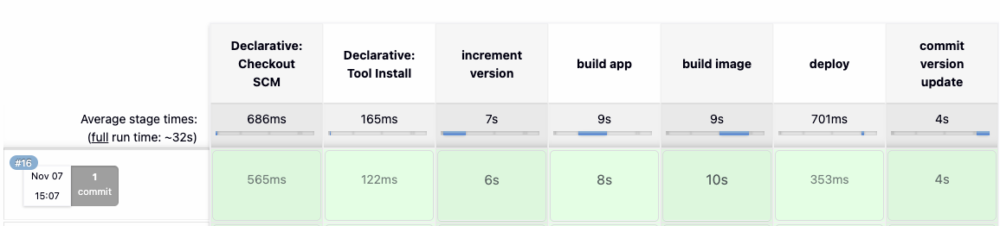
_Build #16 of `my-pipeline`, with the new `commit version update` stage completing after deploy._

 

### Version bump committed to GitHub

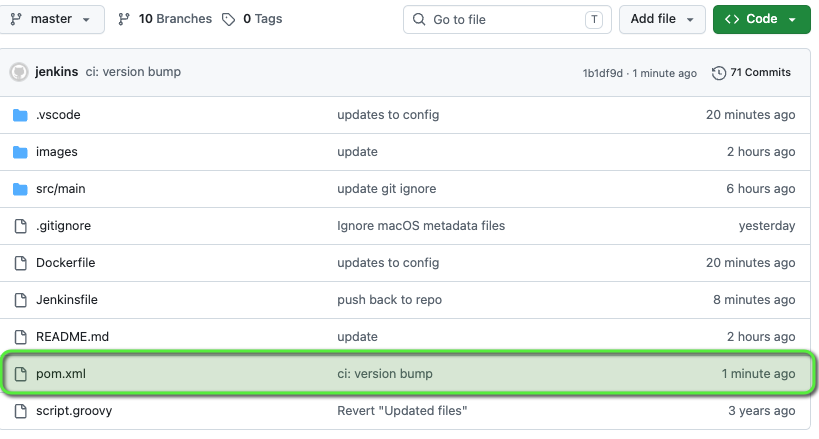
_The `ci: version bump` commit by `jenkins`, updating `pom.xml` on the `master` branch on GitHub._

 

### A new image version for every build

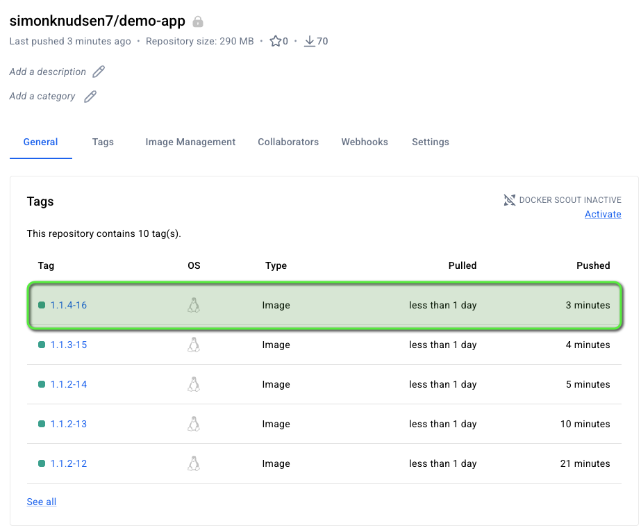
_Tags `1.1.2-12` to `1.1.4-16` on Docker Hub: because each new version is saved to Git, every build picks up where the last one stopped._
