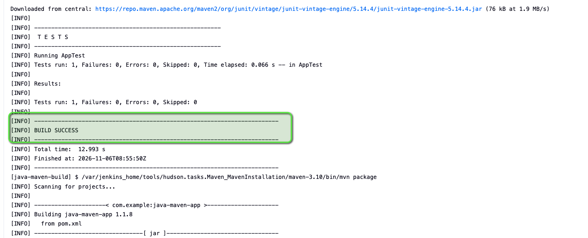
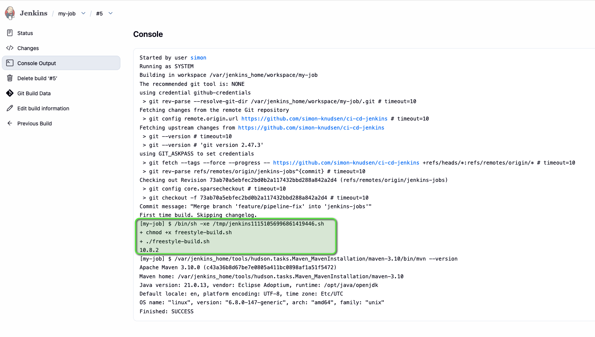
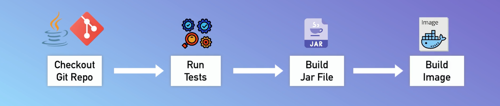
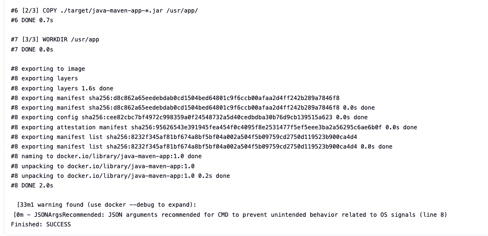
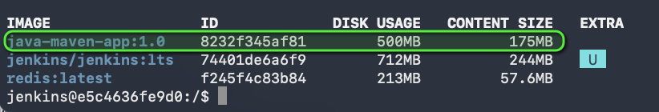
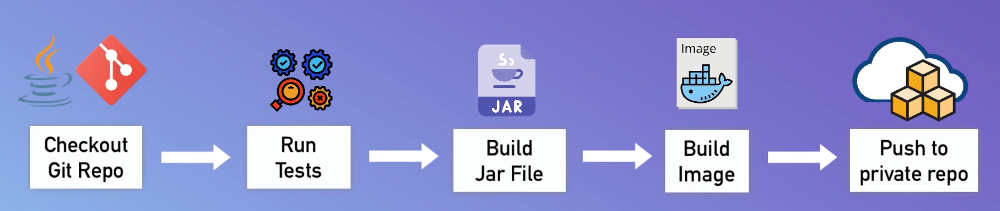
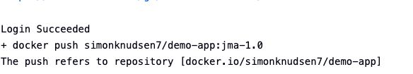
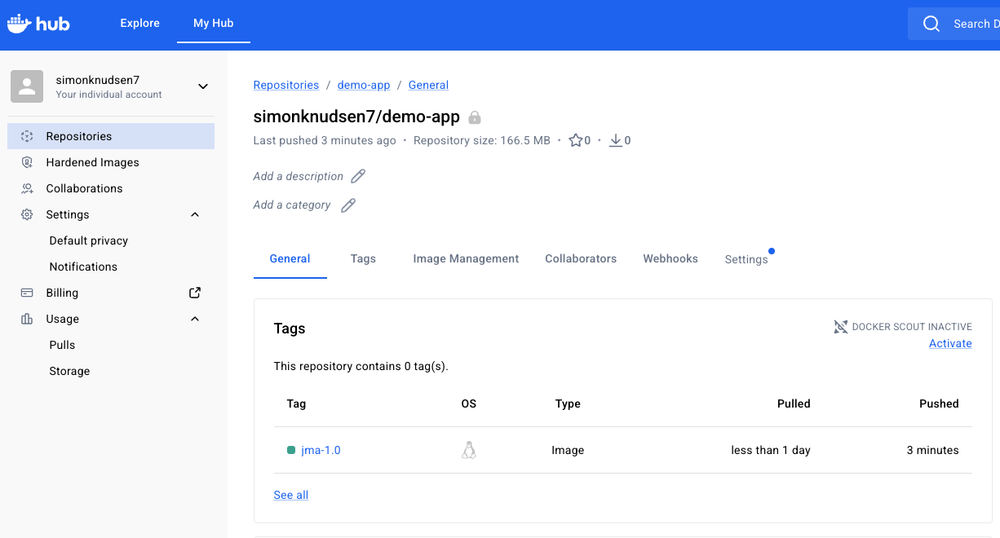
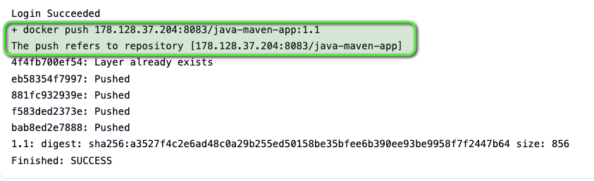
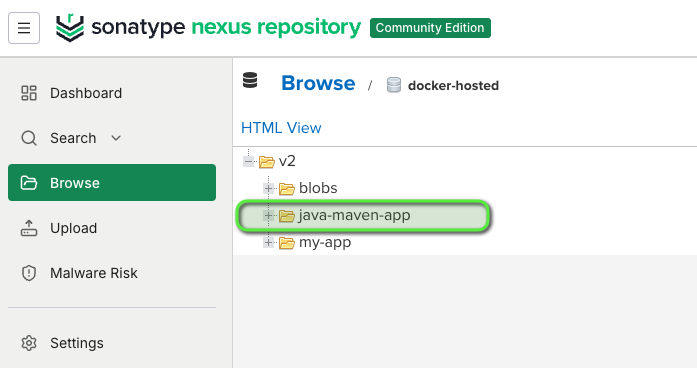

# 1. Install Jenkins on DigitalOcean

## Steps completed

- Created a DigitalOcean server to host Jenkins.
- Set up Docker on the server so Jenkins can run in a container.
- Started Jenkins as a Docker container and exposed its web interface.
- Completed the initial Jenkins setup and prepared it for creating build jobs.

 

# 2. Create a CIPipeline with Jenkinsfile (Freestyle, Pipeline, Multibranch Pipeline)

## Technologies used

- Jenkins
- Docker
- DigitalOcean
- Linux
- Git
- Java
- Maven

 

## Build Jar File

 

_Successful Maven test and package build._

 

_Jenkins job running the configured build commands._

 

## Build image

_Build-image stage added to the CI flow._

_Docker image built successfully._

_Created Docker image verified locally._

 

## Push to private Docker repository

_Push-to-repository stage added to the CI flow._

_Docker image pushed successfully to the private repository._

_Published image available in Docker Hub._

 

## Push to Nexus repository

_Docker image pushed successfully to the Nexus repository._

_Published Java Maven image available in Nexus._

 
