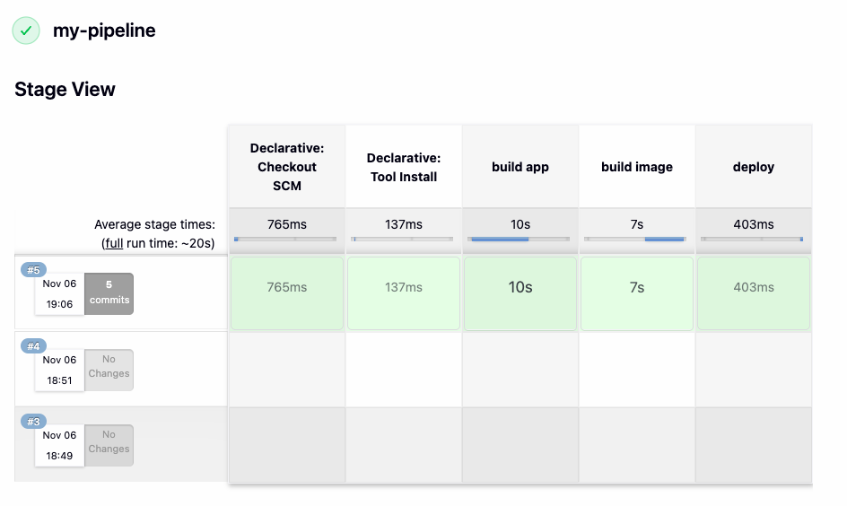

# 1. Install Jenkins on DigitalOcean

## Steps completed

- Created a DigitalOcean server to host Jenkins.
- Set up Docker on the server so Jenkins can run in a container.
- Started Jenkins as a Docker container and exposed its web interface.
- Completed the initial Jenkins setup and prepared it for creating build jobs.

 

# 2. Create a CIPipeline with Jenkinsfile (Freestyle, Pipeline, Multibranch Pipeline)

## Technologies used

- Jenkins
- Docker
- DigitalOcean
- Linux
- Git
- Java
- Maven

 

## Freestyle pipeline

 

### Build Jar File

 

_Successful Maven test and package build._

 

_Jenkins job running the configured build commands._

 

### Build image

_Build-image stage added to the CI flow._

 

_Docker image built successfully._

 

_Created Docker image verified locally._

 

### Push to private Docker repository

_Push-to-repository stage added to the CI flow._

 

_Docker image pushed successfully to the private repository._

 

_Published image available in Docker Hub._

 

### Push to Nexus repository

_Docker image pushed successfully to the Nexus repository._

 

_Published Java Maven image available in Nexus._

 

## Pipeline

The freestyle build steps were replaced with a declarative Jenkins pipeline, which keeps the CI flow defined as code. The pipeline checks out the source code, installs the required tools, and then runs the build app, build image, and deploy stages.

_Jenkins Stage View showing a successful `my-pipeline` run, with all stages completed._
